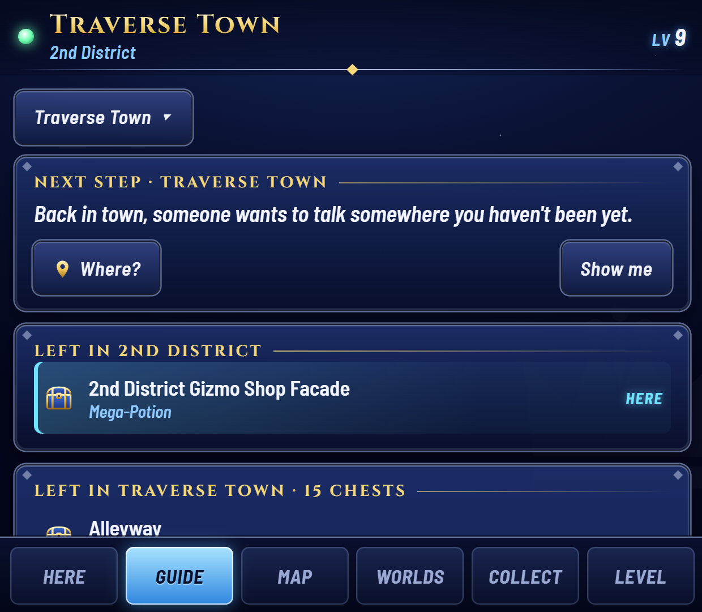
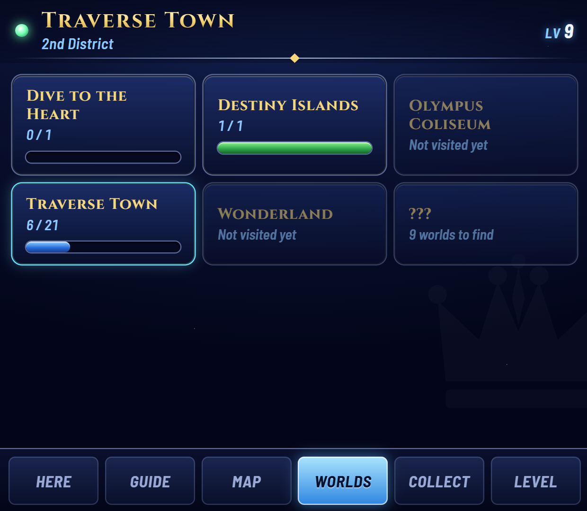
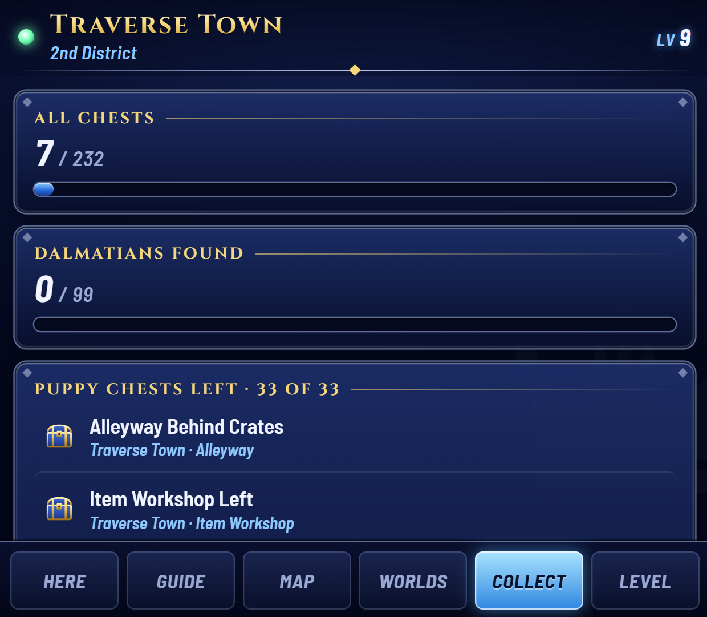

<p align="center"></p>

<p align="center">
  <b>Kingdom Hearts Final Mix on the top screen. Everything you'd look up on the bottom one.</b><br>
  For the AYN Thor and other dual-screen Android handhelds, with the game running in GameNative.
</p>

<p align="center">
  <a href="../../releases"><b>⬇ Download the latest beta</b></a> ·
  <a href="#install">Install</a> ·
  <a href="#what-it-shows">What it shows</a> ·
  <a href="#questions">Questions</a>
</p>

> **Beta.** It works end to end on the AYN Thor, and it's still being tested across a full playthrough. Your game and saves are never changed.

## What it shows

Six tabs, all live from the save you have loaded. It never tells you anything you haven't reached yet unless you ask.

<table>
  <tr>
    <td width="50%"><br><b>Guide</b>: stuck? A gentle nudge first, then <i>Where?</i> for the room, then <i>Show me</i> for the full hint. No boss or reward names until you've earned them.</td>
    <td width="50%"><br><b>Map</b>: every room in the world, where you are, how many chests are left in each, and which rooms or chests you can't reach yet.</td>
  </tr>
  <tr>
    <td><br><b>Here</b>: the chests left in this world, the room you're in pinned to the top, with what's inside if you want to know.</td>
    <td><br><b>Level</b>: what Sora learns at each level for <i>your</i> Dive choices, and how much EXP until the next one. Tap a level for details.</td>
  </tr>
  <tr>
    <td><br><b>Worlds</b>: chest progress everywhere you've been. Worlds you haven't found stay a mystery.</td>
    <td><br><b>Collect</b>: all 232 chests, the 99 Dalmatians, postcards and Ansem's Reports.</td>
  </tr>
</table>

**It reads your save, so there's nothing to keep in sync.** Load any save on any device and it's up to date. Starting the companion partway through a playthrough is fine.

**It looks like part of the game.** Deep-blue menus, silver frames and gold titles, all drawn for this project.

## What you need

- An **AYN Thor**, or another Android handheld with a second screen
- **[GameNative](https://github.com/utkarshdalal/GameNative)** with **KINGDOM HEARTS HD 1.5+2.5 ReMIX** (Steam) installed and launching normally
- About **five minutes** for setup

## Install

1. **Download** `KH1-Companion-….apk` from the [latest release](../../releases) and open it to install.
2. **Open "Kingdom Hearts Final Mix"**, the companion's app. A setup checklist walks you through everything, with pictures of each GameNative screen:
   - two Android permissions (one switch each),
   - copying two files into the game with GameNative's **Import Files** (the app has them ready),
   - adding one setting in GameNative (the app copies the text for you, so there's nothing to type),
   - starting the game once, after which setup ticks itself off.
3. **Play.** From then on, tap the **Kingdom Hearts Final Mix** icon: the game starts on the top screen with the companion on the bottom, and both close together when you quit.

The app is named after the game, so launchers like Cocoon Shell can pick up box art and metadata for it.

## Using it

- **Tap the icon** to play. If the game is already running, it just opens the companion. Tap it again to close the companion.
- **Close it any time** with the **×** at the top of the companion, or **Close** on its notification.
- **Long-press the icon** for *Companion only*, *Close companion* and *Settings*.
- **Nothing shows until a save is loaded**, so you never see leftovers from another save.

## Uninstall

In the app: **Settings → Advanced → Remove everything**.

1. **Remove from the game**, then start the game once. The mod takes itself out of the game folder and never loads again. No GameNative steps.
2. Optional: delete the setting you added in GameNative (harmless to leave).
3. **Delete files**, then **Uninstall**.

Your game and saves are untouched throughout.

## Questions

<details><summary><b>The game shows a black screen.</b></summary>

Set the game's display mode to fullscreen or borderless in its settings. The collection's display settings sync through Steam Cloud, so windowed mode chosen on a PC carries over, and it renders black under GameNative.
</details>

<details><summary><b>The companion keeps saying "Waiting for Kingdom Hearts…".</b></summary>

Tap **Not connecting?** on that screen. It checks what the app can see and tells you which setup step to look at.
</details>

<details><summary><b>Does it change my game or my save?</b></summary>

No. The mod only reads the game's memory and writes a small progress file to your Download folder. It never writes to the game or the save.
</details>

<details><summary><b>I play on PC too. Will it get confused?</b></summary>

No. Everything comes from the save that's loaded right now, so playing on several devices, or syncing through Steam Cloud, just works.
</details>

<details><summary><b>Will it spoil the story?</b></summary>

Not unless you ask. The guide starts with a vague nudge; places, names and full hints are each one tap further. Worlds you haven't found show as "???", future story steps stay hidden, and rewards appear once you've earned them.
</details>

---

## Under the hood

Everything below is for people working on the project.

### How it works

```
KH1 (top screen)  ──LuaBackend──▶  kh1companion.lua  ──▶  state.json  ──▶  companion page (bottom screen)
                                  reads memory only        ~4 Hz, atomic write
```

The game is never patched. [LuaBackend](https://github.com/Sirius902/LuaBackend) (GPL-3.0, shipped unmodified) loads a read-only Lua script that reads game memory and writes a small JSON snapshot about 4 times a second to `D:\KH1Companion\state.json`, which GameNative maps to Android's `Download/`. The Android app shows the page as a non-focusable overlay on the second display, so the top screen keeps the controller, and pushes each snapshot into the page.

Details the tabs rely on:
- **Rooms:** the current room comes from the game's room byte, and every named room in every world is on a map. The header shows the game's own name for the exact room.
- **Reachability:** chests come with what reaching them takes (from Archipelago's logic), checked against the magic, shared abilities, Trinities and key items in the save. Rooms are gated on story points.
- **Level path and curve:** the path is the Dive choice byte; the curve is inferred from EXP at the current level and remembered per device once unambiguous.
- **Discovery:** the save's world-status array says which worlds are hidden, on the Gummi map, or visited.
- **Title screen:** world 0, room 0 with no HUD; every tab waits for a save there.

### Install, by design

The game folder is GameNative's private storage, so no other app can write there, and GameNative 1.3 ignores the `executablePath` in a launch intent's `container_config` (tested on the Thor 2026-10-24: it still runs the Steam loader), so an installer can't be run for the user. Hence the two guided GameNative steps:

1. **Import Files** → `Download/KH1Companion/mod/DINPUT8.dll` and `LuaBackend.toml` → Game Directory. The app stages these (licenses go in `mod/licenses/`, so the picker shows only the two files).
2. Container environment variable `WINEDLLOVERRIDES` = `dinput8=n,b;dbghelp=b`. It's required: without it the bridge doesn't load (tested on the Thor 2026-10-24).
   - **Don't load LuaBackend as `dbghelp`.** Wine's imagehlp forwards to dbghelp, so a global `dbghelp=n,b` hands those calls to LuaBackend's stand-in, which lacks them, and the game aborts (`unimplemented function dbghelp.dll.ImageNtHeader`). As `dinput8` it works, because KH1 imports `DirectInput8Create`, and LuaBackend exits quietly in every other program.

Setup's last step ticks off once the bridge has written its file. The app re-copies the bridge script to `Download/KH1Companion/scripts/` after every update, so script fixes ship with the APK.

**Uninstall:** the app leaves `mod/uninstall.flag`. On the next game start the bridge, running inside the game, renames its own `DINPUT8.dll` (a loaded DLL can't be deleted, but it can be renamed; tested on the Thor), deletes `LuaBackend.toml`, and writes `mod/uninstall.log`.

**Opening and closing:** the icon sends GameNative's `app.gamenative.LAUNCH_GAME` intent (Steam app id 2552430, changeable in Settings) from an invisible activity on the top screen. When a game was started that way, GameNative finishes its screen on exit and hands back, so that activity resumes and closes the overlay; nothing has to watch for the game. If the bridge's file is fresh, the game is already running and the tap just opens the companion. From adb: `am start -n com.kh1companion/.MainActivity --ez start true`.

### Where the data comes from

All public, no game files needed. The vendored copies and their commits are in `tools/sources/`.

- **Memory addresses:** the KH1FM Archipelago client ([gaithern/KH-1FM-AP-LUA](https://github.com/gaithern/KH-1FM-AP-LUA)), [KH1FM-RANDOMIZER](https://github.com/gaithern/KH1FM-RANDOMIZER), [KH1FM-Memory-Map](https://github.com/HydroSulphide/KH1FM-Memory-Map) (Dive choice) and Denhonator's KHPCSpeedrunTools (`magicLevels`).
- **Chest and report names:** [Archipelago](https://github.com/ArchipelagoMW/Archipelago) `worlds/kh1/Locations.py` (MIT). Chest location ID = `2650000 + byte*10 + bit`, so a raw flag bit maps straight to a named chest.
- **Chest rooms and contents:** the KH1FM randomizer's documentation (MIT): 217 of 232 chests have a room; the rest are matched by name prefix.
- **Room and world names by byte:** [Dekirai/MultiPresence](https://github.com/Dekirai/MultiPresence) `Models/KH1/Rooms.cs` and `Worlds.cs` (MIT).
- **Story milestones:** the Archipelago client's per-world story-progress thresholds (credited to RetroAchievements' code notes). Nudges and hints are written for this project. Destiny Islands errands use the inventory slots the Archipelago client writes raft items to.
- **What a chest needs:** Archipelago `worlds/kh1/Rules.py` (MIT), read at Beginner difficulty with randomizer options off. Anything it can't express counts as met, so a chest is never wrongly shown as locked.
- **Level-ups:** the randomizer's battle-table docs (MIT). Ability descriptions are written for this project.
- **Map layout and exits:** the [Kingdom Hearts Wiki](https://www.khwiki.com/) "Settings and Areas" section of each world.

### Layout

| Path | What |
|---|---|
| `lua/kh1companion.lua` | Game bridge. Read-only (apart from removing itself on request); detects Steam vs Epic; writes `state.json`. |
| `companion/` | The bottom-screen page. `logic.js` is the decoding (shared with tests), `maps.js` the hand-authored world maps, `guide.js` the story steps, `data.js` is generated. Plain HTML, no build step. |
| `companion/theme.css`, `art/`, `fonts/` | KH1-menu look. Original SVG art only; Cinzel and Barlow Semi Condensed under the SIL OFL, bundled so the app works offline. |
| `android/` | Android app: setup, the overlay service, Play (launch through GameNative). `assets/mod/` holds LuaBackend; `assets/guide/` the setup pictures. |
| `docs/` | README banner (`banner.html` → `banner.png`) and screenshots. |
| `dev/preview.html`, `dev/scenarios/` | Two-screen preview with a live change log, and fixed sample saves (`/?state=/dev/scenarios/<name>.json&view=<tab>`). |
| `tools/devserver.py` | Serves the page plus live, recorded or replayed state. |
| `tools/gen_data.py`, `tools/ap_rules.py` | Regenerate `companion/data.js` from `tools/sources/`, including each chest's requirements. |
| `tools/build_gamenative_mod.py` | Fetches LuaBackend and writes the mod files into the app's assets. |
| `tools/make_scenarios.py`, `tools/make_screenshots.py`, `tools/make_guide_images.py` | Sample saves; README screenshots and banner (headless Chrome); setup pictures from GameNative screenshots. |
| `tools/test_logic.mjs`, `tools/test_bridge.py` | Node tests for decoding, maps, guide and levels plus recorded fixtures; the Lua bridge against fake memory (needs `pip install lupa`). |
| `tools/emulator_test.py`, `tools/mock_state.py` | Two-display emulator check of the overlay; a fake, changing state file for UI work. |

### Dev environment

```bash
python tools/devserver.py --record
```

- Open http://localhost:8737/dev/ for the two-screen preview. Its top half is a change log that names every chest flag as it flips.
- `--record` saves real changes to `recordings/`; load one in the preview to replay it.
- `--lan` makes the server reachable from the Thor; set the app's dev URL to it and page edits show up on the real bottom screen with no rebuild.
- Without the game: `python tools/make_scenarios.py` for fixed saves, or `python tools/mock_state.py` then `python tools/devserver.py --state mock/state.json`.

Tests:

```bash
node --test tools/test_logic.mjs
```

The portable toolchain (JDK 17, Android SDK, Gradle, Node) lives in `C:\Users\lasco\dev-tools`. To build the APK:

```bash
cd android && JAVA_HOME=C:/Users/lasco/dev-tools/jdk17 ANDROID_HOME=C:/Users/lasco/dev-tools/android-sdk ./gradlew assembleDebug
```

**PC game setup (2026-10-23):** LuaBackend v1.9.1 (`DBGHELP.dll` + `LuaBackend.toml`) is in the Steam KH folder, with its KH1 script path pointing at this repo's `lua/`; **F1** reloads scripts, **F2** opens the console. To remove: delete `DBGHELP.dll` and `LuaBackend.toml` from the KINGDOM HEARTS -HD 1.5+2.5 ReMIX- folder, and `%LOCALAPPDATA%\KH1Companion\`.

**Thor prototype:** the in-app Remove everything covers it (the hand-installed files are the same ones). If you set the container's executable to `KINGDOM HEARTS FINAL MIX.exe` to skip the collection menu, you can set it back.

### Releasing

Bump `versionCode`/`versionName` in `android/app/build.gradle.kts`, update `RELEASE_NOTES.md` (it becomes the release page), and push a `v*` tag. CI builds a release APK signed with the project key from the repo secrets (`KH1C_KEYSTORE_B64`, `KH1C_KEYSTORE_PASSWORD`, `KH1C_KEY_ALIAS`, `KH1C_KEY_PASSWORD`). Tags with a `-` (e.g. `v0.9.0-beta.2`) are pre-releases; the plan is to stay pre-release until a full playthrough. The key lives outside the repo (`C:\Users\lasco\dev-tools\keys\`); keep a backup, since a different key can't update existing installs.

### Status

| Piece | State |
|---|---|
| Bridge | Runs on the Steam build under GameNative on the Thor; edition, world/room, level/stats, chest flags and story progress confirmed live. |
| Companion | All six tabs, tested at bottom-screen size against sample saves and real recordings. |
| Maps | All 14 worlds from the wiki; dashed exits are the wiki's implications, not confirmed. |
| Android app | Live on the Thor: overlay on the 1240×1080 bottom screen (density 369), top screen keeps focus, plays and closes with the game, guided setup, self-removing uninstall. |

**Not yet checked against a live save:**
- The newer reads: EXP, learned abilities, inventory, magic, shared abilities, Trinities, world status and the Dive choice byte. Everything that uses them stays quiet when a value is missing (nothing locked, path and curve left to pick).
- The growth-curve byte: the five bytes after the Dive choice are sent to look for it.
- Destiny Islands can't tell the second day from the night yet; `progress_pre[1]` is sent so a recording can calibrate it.
- The Dalmatian count assumes one save-flag bit per puppy.

### Roadmap

- Calibrate the Destiny Islands and Dive steps from `progress_pre` once there's a recording.
- More room gates (Traverse Town's later areas, End of the World).
- Trinity marks (flag offsets are in the randomizer's `globals.lua`).
- Synthesis helper.
