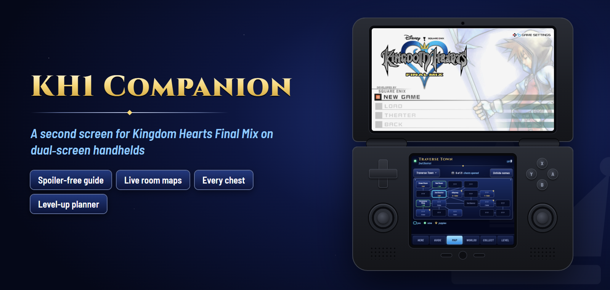
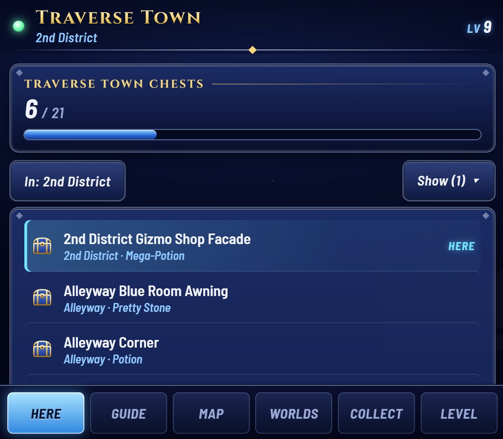
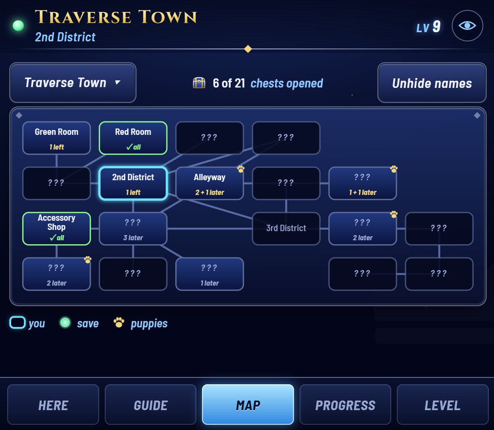
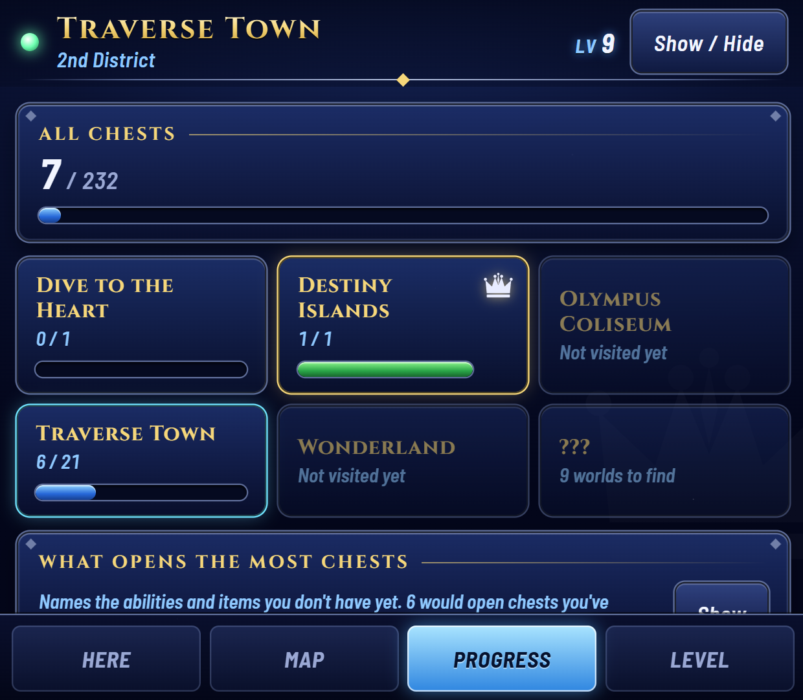
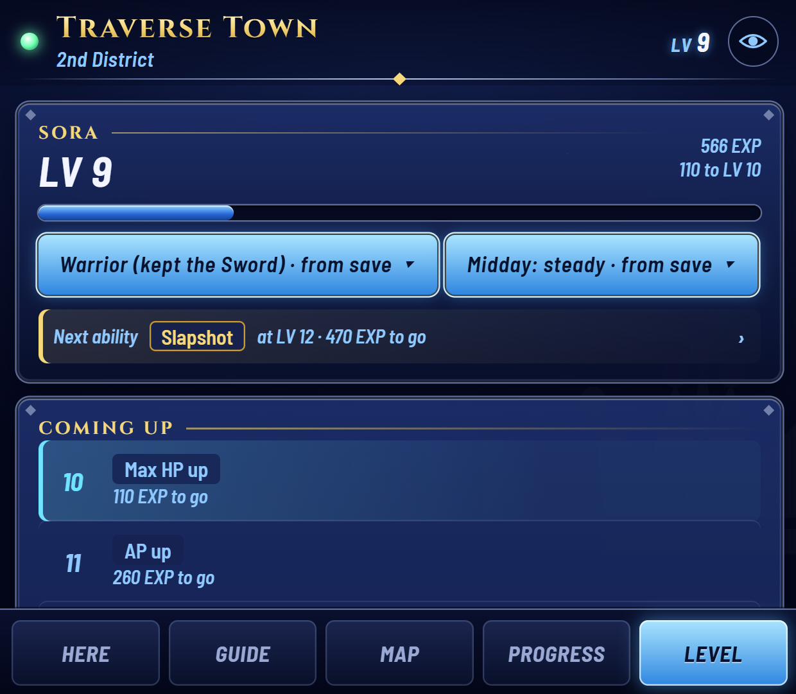
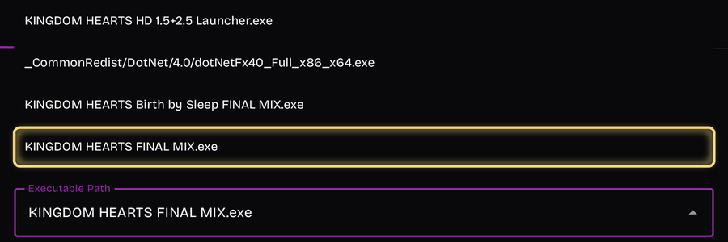

<p align="center"></p>

<p align="center">
  <b>Kingdom Hearts Final Mix on the top screen. Everything you'd look up on the bottom one.</b><br>
  For the AYN Thor and other dual-screen Android handhelds, with the game running in GameNative.
</p>

<p align="center">
  <a href="../../releases"><b>⬇ Download the latest beta</b></a> ·
  <a href="#install">Install</a> ·
  <a href="#what-it-shows">What it shows</a> ·
  <a href="#smoother-play-on-the-ayn-thor">Performance tips</a> ·
  <a href="#questions">Questions</a>
</p>

> **Beta.** It works end to end on the AYN Thor, and it's still being tested across a full playthrough. Your game and saves are never changed.

## What it shows

Four tabs, all live from the save you have loaded, and only what the game's own data proves. Rooms you haven't been to stay "???" unless you ask.

<table>
  <tr>
    <td width="50%"><br><b>Here</b>: an EXP bar to your next level (the game hides it in the Status menu), the chests in the room you're in, and which other rooms still hold chests. Tap a chest to see where it is. Below, the world's bosses (see Progress). A chest the walkthroughs agree needs something you don't have yet (Glide, a Trinity, a spell) is marked <i>Later</i>, and one they agree opens up after an event or on a later visit says so.</td>
    <td width="50%"><br><b>Map</b>: every room in the world, where you are, and how many chests are left in each. The save points shown are the ones found so far, not every one.</td>
  </tr>
  <tr>
    <td><br><b>Progress</b>: every world you've found with its chests (a crown when they're all open), the 99 Dalmatians, postcards and Ansem's Reports. Open a world for its chests and bosses: each boss stays ??? until you tap for the next one, then shows a few tips; ones your save proves beaten tick themselves.</td>
    <td><br><b>Level</b>: what Sora learns at each level for <i>your</i> Dive choices, your next ability and how much EXP until it. Tap a level for details.</td>
  </tr>
  <tr>
    <td colspan="2"><b>First time or replay?</b> Tap the eye at the top: <i>Replay</i> shows room names and chest contents up front. It also has optional pop-up notes for chests, level-ups and new worlds (off by default).</td>
  </tr>
</table>

**It reads your save, so there's nothing to keep in sync.** Load any save on any device and it's up to date. Starting the companion partway through a playthrough is fine.

**It looks like part of the game.** Deep-blue menus, silver frames and gold titles, all drawn for this project.

## What you need

- An **AYN Thor**, or another Android handheld with a second screen
- **[GameNative](https://github.com/utkarshdalal/GameNative)** with **KINGDOM HEARTS HD 1.5+2.5 ReMIX** (Steam) installed and launching normally
- About **five minutes** for setup

Setup's pictures and the steps below were made with **GameNative 1.3.0** on an **AYN Thor** (Android 13), with KINGDOM HEARTS HD 1.5+2.5 ReMIX from Steam (KH1 Final Mix 1.0.0.10). If you're on a different GameNative version, menu names and positions may differ.

## Install

1. **Download** `KH1-Companion-….apk` from the [latest release](../../releases) and open it to install.
2. **Open KH1 Companion.** A setup checklist walks you through everything, with pictures of each GameNative screen:
   - two Android permissions (one switch each),
   - in GameNative, copying two files into the game with **Import Files** (the app has them ready) and turning on **Enable mod loaders**,
   - starting the game once, after which setup ticks itself off.
3. **Open it with the game.** On Cocoon Shell, set **KH1 Companion** as Kingdom Hearts' companion app: launching the game from Cocoon then opens the companion on the bottom screen too. Without Cocoon, start the game and tap the **KH1 Companion** icon. Either way, the companion closes by itself when the game does.

**Optional: start straight into the game.** Out of the box, GameNative opens the collection's menu and you pick KH1 there; quitting KH1 drops you back in that menu, and the companion closes within a minute. For a seamless KH1 experience, point GameNative straight at KH1: in GameNative open the game → ⚙ → **Edit container** → **General** → **Executable Path** → `KINGDOM HEARTS FINAL MIX.exe` → save. Setup's step 6 shows each screen. To go back, pick `KINGDOM HEARTS HD 1.5+2.5 Launcher.exe` the same way.

<p align="center"></p>

## Using it

- **Tap the KH1 Companion icon** to open the companion (or let Cocoon open it with the game). It closes by itself as soon as the game exits.
- **Close it any time** with the **×** at the top of the companion, or **Close** on its notification.
- **Settings:** tap **×** on the companion → **Settings** (or **Settings** on its notification; on launchers with icon menus, long-press the icon).
- **Nothing shows until a save is loaded**, so you never see leftovers from another save.

## Smoother play on the AYN Thor

These settings have nothing to do with the companion (it uses next to nothing while the game runs), but they made KH1 itself play noticeably better on our Thor (GameNative 1.3.0), measured frame by frame:

| Setting | Where | What it fixed |
|---|---|---|
| **Top screen at 120 Hz** | Thor display settings | Uneven frame pacing and input lag: frames reached the screen in about 6 ms instead of about 60 ms, with far fewer hitches. The game still runs at 60. |
| **FEXCore Preset: Performance** | GameNative → the game → ⚙ → **Edit container** → **Emulation** | The frame-rate dips when turning the camera. The game's main thread was maxing out one CPU core; this preset lightens it. If you ever see glitches, set it back to *Intermediate*. |
| **High Performance mode** | The Thor's per-app panel: while the game runs, swipe in from the right edge of the top screen | The remaining dips: it keeps the CPU at full speed. Costs battery and heat, so *Performance* mode is the gentler choice. It applies to GameNative as a whole (every game in it), not the whole system. |
| **A fan mode to match** | Same per-app panel: pick the fan mode (we use *Smart*). Edit the *Smart* curve itself from Quick Settings (swipe down from the top of the screen) | High Performance runs warmer, so adjust the fan as needed. We use a less aggressive *Smart* curve: cool enough, and quieter. |
| **Keep GameNative's FPS limiter at 60** | GameNative's in-game menu | Turning it off made pacing worse, not better. |
| **Borderless windowed in KH1** | The game's own options | The display mode we play in. (Plain windowed mode shows a black screen under GameNative; see Questions.) |
| **720p (1280×720) in GameNative** | GameNative's resolution setting for the game's container | The resolution we play at: the game renders less, leaving more headroom, and it still looks sharp on the Thor's screen. |
| **V-Sync and the frame limiter off in KH1** | The game's own options | The usual recommendation under GameNative: let GameNative's limiter do the pacing rather than stacking the game's on top. Our measurements were taken this way. |

With these settings (fan aside), the game spent about 4% of a two-minute camera-spinning test below 54 fps, down from 20%, and the worst dip went from 36 to 48 fps.

## Uninstall

In the app's Settings (tap **×** on the companion → **Settings** (or **Settings** on its notification; on launchers with icon menus, long-press the icon)), tap **Remove everything…**. Setup pauses while you go through it; **Set up again** brings it back if you change your mind.

1. **Remove from the game**, then start the game once. The mod takes itself out of the game folder and never loads again. No GameNative steps.
2. Optional: turn off **Enable mod loaders** in GameNative (harmless to leave), and if you pointed the game straight at KH1, set Executable Path back to `KINGDOM HEARTS HD 1.5+2.5 Launcher.exe`.
3. **Delete files** (it asks first), then **Uninstall**.

Your game and saves are untouched throughout.

## Questions

<details><summary><b>The game shows a black screen.</b></summary>

Set the game's display mode to fullscreen or borderless in its settings. The collection's display settings sync through Steam Cloud, so windowed mode chosen on a PC carries over, and it renders black under GameNative.
</details>

<details><summary><b>The game stutters or dips when I turn the camera.</b></summary>

See [Smoother play on the AYN Thor](#smoother-play-on-the-ayn-thor): 120 Hz, the FEXCore *Performance* preset and the Thor's High Performance mode fixed most of it for us.
</details>

<details><summary><b>The companion keeps saying "Waiting for Kingdom Hearts…".</b></summary>

Tap **Not connecting?** on that screen. It checks what the app can see and tells you which setup step to look at.
</details>

<details><summary><b>Does it change my game or my save?</b></summary>

No. The mod only reads the game's memory and writes a small progress file to your Download folder. It never writes to the game or the save.
</details>

<details><summary><b>I play on PC too. Will it get confused?</b></summary>

No. Everything comes from the save that's loaded right now, so playing on several devices, or syncing through Steam Cloud, just works.
</details>

<details><summary><b>Will it spoil the story?</b></summary>

No. Worlds and rooms you haven't found show as "???", and chest contents stay hidden until you ask. On a replay, tap the eye at the top and pick **Replay** to see everything up front.
</details>

---

## Under the hood

Everything below is for people working on the project.

### How it works

```
KH1 (top screen)  ──LuaBackend──▶  kh1companion.lua  ──▶  state.json  ──▶  companion page (bottom screen)
                                  reads memory only        ~4 Hz, atomic write
```

The game is never patched. [LuaBackend](https://github.com/Sirius902/LuaBackend) (GPL-3.0, shipped unmodified) loads a read-only Lua script that reads game memory and writes a small JSON snapshot about 4 times a second to `D:\KH1Companion\state.json`, which GameNative maps to Android's `Download/`. The Android app shows the page as a non-focusable overlay on the second display, so the top screen keeps the controller, and pushes each snapshot into the page.

Details the tabs rely on:
- **Rooms:** the current room comes from the game's room byte, and every named room in every world is on a map. The header shows the game's own name for the exact room.
- **Level path and curve:** the path is the Dive choice byte; the curve has no save byte, so every EXP reading of the playthrough rules curves out until one is left (lower EXP means a new game).
- **Discovery:** the save's world-status array says which worlds are hidden, on the Gummi map, or visited. KH1 keeps no record of visited rooms, so a room's name shows once this device has seen you there or you've opened a chest in it; the map's "Unhide names" chip (or Replay mode) shows them all.
- **Title screen:** world 0, room 0 with no HUD; every tab waits for a save there. The Dive's weapon choice reads the same, so the Dive's story byte (or save data changing) tells them apart.
- **Pop-up notes (optional, off by default):** each snapshot is compared with the last one (chest flags, level, puppies, reports, world status). Loading a save, or a jump too big to be play, only resets that baseline, so nothing old is announced.

### Install, by design

The game folder is GameNative's private storage, so no other app can write there, and GameNative 1.3 ignores the `executablePath` in a launch intent's `container_config` (tested on the Thor 2026-10-24: it still runs the Steam loader), so an installer can't be run for the user. Hence one guided GameNative step, in two parts:

1. **Import Files** → `Download/KH1Companion/mod/DINPUT8.dll` and `LuaBackend.toml` → Game Directory. The app stages these (licenses go in `mod/licenses/`, so the picker shows only the two files).
2. **Edit container → General → Enable mod loaders.** Wine's built-in `dinput8` wins over the game folder's, so the bridge needs a `dinput8=n,b` DLL override. With this switch on, GameNative adds it at launch for any `dinput8.dll` beside the game's exe (`ModDllOverrides`, GameNative 1.3.0), so nothing is typed (tested on the Thor 2026-10-25, launched from Cocoon). Setting `WINEDLLOVERRIDES=dinput8=n,b` on the Environment tab does the same, which is what earlier betas had people do. Adding the mod folder to `WINEPATH` instead does not work: the built-in still wins.
   - **Don't load LuaBackend as `dbghelp`.** Wine's imagehlp forwards to dbghelp, so a global `dbghelp=n,b` hands those calls to LuaBackend's stand-in, which lacks them, and the game aborts (`unimplemented function dbghelp.dll.ImageNtHeader`). As `dinput8` it works, because KH1 imports `DirectInput8Create`, and LuaBackend exits quietly in every other program.

Setup's last step ticks off once the bridge has written its file. The app re-copies the bridge script to `Download/KH1Companion/scripts/` after every update, so script fixes ship with the APK.

**Uninstall:** the app leaves `mod/uninstall.flag`. On the next game start the bridge, running inside the game, renames its own `DINPUT8.dll` (a loaded DLL can't be deleted, but it can be renamed; tested on the Thor), deletes `LuaBackend.toml`, and writes `mod/uninstall.log`.

**Opening and closing:** the icon only opens the companion; a launcher starts the game (Cocoon Shell's companion-app setting sends GameNative `app.gamenative.LAUNCH_GAME`, then opens this app). Alongside the overlay, an invisible `WatchActivity` hops under GameNative on the top screen and brings GameNative's existing window forward (never a second launch). When the game exits, GameNative finishes its screen, the watcher resumes and closes the overlay, within a frame or two of the exit. Backup: the bridge going quiet for a minute with the screen on (five right after the title, for the opening movie). Setup's "Start the game" still sends `LAUNCH_GAME` itself (Steam app id 2552430, changeable in Settings). From adb: `am start -n com.kh1companion/.MainActivity --ez start true`.

### Where the data comes from

All public, no game files needed. The vendored copies and their commits are in `tools/sources/`.

- **Memory addresses:** the KH1FM Archipelago client ([gaithern/KH-1FM-AP-LUA](https://github.com/gaithern/KH-1FM-AP-LUA)), [KH1FM-RANDOMIZER](https://github.com/gaithern/KH1FM-RANDOMIZER), [KH1FM-Memory-Map](https://github.com/HydroSulphide/KH1FM-Memory-Map) (Dive choice) and Denhonator's KHPCSpeedrunTools (`magicLevels`).
- **Chest and report names:** [Archipelago](https://github.com/ArchipelagoMW/Archipelago) `worlds/kh1/Locations.py` (MIT). Chest location ID = `2650000 + byte*10 + bit`, so a raw flag bit maps straight to a named chest.
- **Chest rooms and contents:** the KH1FM randomizer's documentation (MIT): 217 of 232 chests have a room; the rest are matched by name prefix.
- **Room and world names by byte:** [Dekirai/MultiPresence](https://github.com/Dekirai/MultiPresence) `Models/KH1/Rooms.cs` and `Worlds.cs` (MIT).
- **Chest locations:** written for this project from the KH Wiki's KH1 walkthroughs (`companion/chesthints.js`); where a chest isn't clearly placed there, the hint says only what its Archipelago name says.
- **What a chest needs:** cross-checked across eight walkthroughs (the KH Wiki, six GameFAQs guides, IGN) and kept only where two or more state it and none says otherwise: 55 chests (`companion/chestneeds.js`). Where guides disagree or only one says something, the chest's sheet shows a note instead, including when an ability only makes a chest easier. Sources and disagreements: [docs/chest-needs-sources.md](docs/chest-needs-sources.md).
- **When a chest opens up:** the same eight plus the Kingdom Hearts Wiki on Fandom, GamerGuides and TrueTrophies (both Final Mix). Where two or more agree and none gets it sooner, the chest says *After* an event in that world (19 chests) or *Later visit* (49). Same rules, same document.
- **Bosses:** the list, order and tips from the same walkthroughs, a tip kept only where two or more say it; a boss ticks only on save evidence (the Archipelago client's story thresholds, the Ansem's Report or reward it gives). Sources: [docs/bosses-sources.md](docs/bosses-sources.md).
- **Level-ups:** the randomizer's battle-table docs (MIT). Ability descriptions are written for this project.
- **Map layout and exits:** the [Kingdom Hearts Wiki](https://www.khwiki.com/) "Settings and Areas" section of each world.

### Layout

| Path | What |
|---|---|
| `lua/kh1companion.lua` | Game bridge. Read-only (apart from removing itself on request); detects Steam vs Epic; writes `state.json`. |
| `companion/` | The bottom-screen page. `logic.js` is the decoding (shared with tests), `maps.js` the hand-authored world maps, `chesthints.js` where each chest is, `chestneeds.js` what a chest needs, `bosses.js` each world's bosses, `data.js` is generated. Plain HTML, no build step. |
| `companion/theme.css`, `art/`, `fonts/` | KH1-menu look. Original SVG art only; Cinzel and Barlow Semi Condensed under the SIL OFL, bundled so the app works offline. |
| `android/` | Android app: setup, the overlay service, and the watcher that closes it with the game. `assets/mod/` holds LuaBackend; `assets/guide/` the setup pictures. |
| `docs/` | README banner (`banner.html` → `banner.png`) and screenshots (companion 0.9.0 betas, rendered from sample saves). |
| `dev/preview.html`, `dev/scenarios/` | Two-screen preview with a live change log, and fixed sample saves (`/?state=/dev/scenarios/<name>.json&view=<tab>`). |
| `tools/devserver.py` | Serves the page plus live, recorded or replayed state. |
| `tools/gen_data.py`, `tools/ap_rules.py` | Regenerate `companion/data.js` from `tools/sources/`, including each chest's requirements. |
| `tools/build_gamenative_mod.py` | Fetches LuaBackend and writes the mod files into the app's assets. |
| `tools/make_scenarios.py`, `tools/make_screenshots.py`, `tools/make_guide_images.py` | Sample saves; README screenshots and banner (headless Chrome); setup pictures from GameNative screenshots. |
| `tools/test_logic.mjs`, `tools/test_bridge.py` | Node tests for decoding, maps, chests and levels plus recorded fixtures; the Lua bridge against fake memory (needs `pip install lupa`). |
| `tools/kh1save.py` | Reads real KH1FM PC saves (`KHFM_WW.png`, or GameNative's *Export saves* ZIP): lists the slots and turns each into the bridge's `state.json`, since a save slot is the same block of memory the bridge reads. |
| `tools/emulator_test.py`, `tools/mock_state.py` | Two-display emulator check of the overlay; a fake, changing state file for UI work. |

### Dev environment

```bash
python tools/devserver.py --record
```

- Open http://localhost:8737/dev/ for the two-screen preview. Its top half is a change log that names every chest flag as it flips.
- `--record` saves real changes to `recordings/`; load one in the preview to replay it.
- `--lan` makes the server reachable from the Thor; set the app's dev URL to it and page edits show up on the real bottom screen with no rebuild.
- Without the game: `python tools/make_scenarios.py` for fixed saves, or `python tools/mock_state.py` then `python tools/devserver.py --state mock/state.json`.
- From a real save: in GameNative, the game → ⚙ → **Export saves**, then `python tools/kh1save.py state <the ZIP> mock` and `python tools/devserver.py --state mock/save-<slot>.json`.

Tests:

```bash
node --test tools/test_logic.mjs tools/test_story.mjs
```

The portable toolchain (JDK 17, Android SDK, Gradle, Node) lives in `C:\Users\lasco\dev-tools`. To build the APK:

```bash
cd android && JAVA_HOME=C:/Users/lasco/dev-tools/jdk17 ANDROID_HOME=C:/Users/lasco/dev-tools/android-sdk ./gradlew assembleDebug
```

**PC game setup (2026-10-23):** LuaBackend v1.9.1 (`DBGHELP.dll` + `LuaBackend.toml`) is in the Steam KH folder, with its KH1 script path pointing at this repo's `lua/`; **F1** reloads scripts, **F2** opens the console. To remove: delete `DBGHELP.dll` and `LuaBackend.toml` from the KINGDOM HEARTS -HD 1.5+2.5 ReMIX- folder, and `%LOCALAPPDATA%\KH1Companion\`.

**Thor prototype:** the in-app Remove everything covers it (the hand-installed files are the same ones). If you set the container's executable to `KINGDOM HEARTS FINAL MIX.exe` to skip the collection menu, you can set it back.

### Releasing

Bump `versionCode`/`versionName` in `android/app/build.gradle.kts`, update `RELEASE_NOTES.md` (it becomes the release page), and push a `v*` tag. CI builds a release APK signed with the project key from the repo secrets (`KH1C_KEYSTORE_B64`, `KH1C_KEYSTORE_PASSWORD`, `KH1C_KEY_ALIAS`, `KH1C_KEY_PASSWORD`). Tags with a `-` (e.g. `v0.9.0-beta.2`) are pre-releases; the plan is to stay pre-release until a full playthrough.

**Naming:** a new beta number (`v0.9.0-beta.6`) for new features or anything that changes setup; a light revision (`v0.9.0-beta.6.1`, `.2`, ...) for fixes only, which install over the last one with nothing to redo. Either way `versionCode` goes up by one. Release notes stay short: what changed, how to update, and a link to this page. The key lives outside the repo (`C:\Users\lasco\dev-tools\keys\`); keep a backup, since a different key can't update existing installs.

### Testing so far

Played on an AYN Thor (Steam build, GameNative 1.3.0) from a new game through Destiny Islands and into Traverse Town.

**High confidence (seen working in play):** install, setup and uninstall; opening and closing with the game from Cocoon; the room you're in; chests opened, per room and world; EXP and level-ups; the Dive's choice; Destiny Islands' items; no frame-rate cost (camera-spin test, companion open and closed).

**Not yet seen in play:** worlds after Traverse Town (maps, chest rooms and contents come from the KH Wiki and the randomizer's data); Trinities, shared abilities and learned spells, which decide whether a chest's "Needs" line shows; the Dalmatian count (assumes one save bit per puppy).
